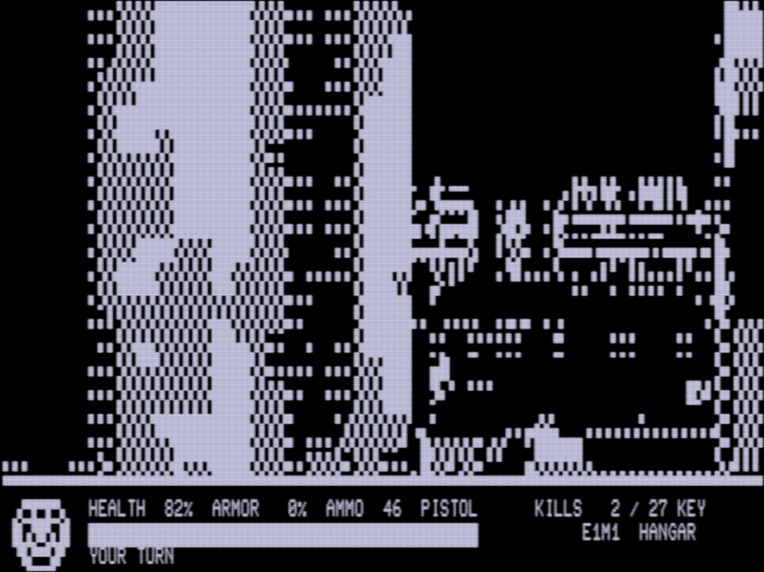

# DOOM on the TRS-80 Model 4

Freedoom's first level, E1M1, running on a stock 128 KB **Tandy TRS-80 Model 4**: a 4 MHz Z80 and an 80 x 24 text
screen with no bitmap graphics. The 3D view is drawn with the character set's 2 x 3 block characters
(160 x 60 block pixels), and the status bar is plain text.



**This is a first running demo, and I welcome collaboration.** I left out some hacks that don't seem to work on
every Model 4, so I think this can be pushed a bit further. Issues, ideas, pull requests and reports from real
hardware are all welcome.

**[Watch the demo](media/demo.mp4)** (8 minutes, with sound, recorded in trs80gp): TRSDOS boots, the program loads,
and the computer plays E1M1 to the exit switch. Screenshots are in [media/](media/). The project page is
[index.html](index.html).

## Run it
```
./setup.sh      # once: builds zmac, unpacks trs80gp, clones Freedoom into freedoom/
./run.sh        # builds build/DOOM.CMD; trs80gp boots TRSDOS 6 and runs it
make test       # the checks
```
On a real Model 4 with 128 KB: copy `DOOM/CMD` to a TRSDOS 6 or LS-DOS 6 disk and type `DOOM`. It needs all
128 KB. So far it has been run in trs80gp, not on real hardware.

| Key | Action |
|---|---|
| **W / UP**, **S / DOWN** | forward / back |
| **A / LEFT**, **D / RIGHT** | turn |
| **SPACE** | open a door, press the exit switch |
| **F** or **CTRL** | fire |
| **T** | the computer plays; **T** again takes it back |
| **BREAK** | quit (the machine restarts) |

## What's in it
* E1M1's layout on a grid of 64-unit cells, with doors and the exit switch.
* 15 of the level's wall textures in four shades of grey, and darker walls where the level's light is low.
* Zombiemen, shotgun guys, imps and demons where E1M1 places them, each with its own pictures, health and attack.
* Health and armour bonuses, stimpacks, medikits, clips, shells, armour, a keycard, barrels, trees, stalagmites
  and lamps.
* A status bar: HEALTH, ARMOR, AMMO, the weapon in hand, KILLS, the keycard, a face drawn in block graphics and a
  health bar, with messages on the bottom row.
* A floor that reflects the walls.
* Sound on the Model 4's one-bit speaker.

## How it's built
`scripts/gen_assets.py` reads Freedoom's E1M1, textures and sprites (through `wad.py` and `grid.py`) and writes
tables for the assembler. `zmac` assembles `doomm4.asm` (the engine), `deeds.asm` (the game) and the rest into one
TRSDOS `/CMD` file. When it starts, the program builds its lookup tables and its wall and sprite images in the
Model 4's upper memory banks.

`make test` runs the program in trs80gp and checks it: the images and tables it builds must match the Python
versions byte for byte, every test screen must match a Python copy of the renderer (`scripts/model.py`) byte for
byte, and the computer player must reach the exit.

Notes on the machine and the emulator are in [docs/QUIRKS.md](docs/QUIRKS.md).

## Limits
* One floor height. Diagonal walls become steps on the grid, and each wall cell shows one texture.
* Four greys, 160 x 60 block pixels for the view.
* Monsters always show their front view; imp fireballs and shotgun blasts hit at once, like bullets.
* One kind of ammunition; the fist and the pistol (E1M1 has no other weapon at this skill level).

## Credits
* **Freedoom** (https://freedoom.github.io/) by the Freedoom project's contributors: the level, textures and
  sprites, under Freedoom's BSD-style licence. Freedoom's files are not in this repository; `setup.sh` clones them.
  The screenshots and the video show Freedoom's art as the Model 4 draws it, and programs built from Freedoom
  carry its art, so pass Freedoom's licence along with them.
* **DOOM** was created by id Software, and DOOM is a trademark of its owners. This is an unofficial fan project, not
  affiliated with or endorsed by id Software, Bethesda or ZeniMax. No id Software data or code is used.
* **trs80gp** and **zmac** by George Phillips (http://48k.ca/). TRS-80 and Tandy are trademarks of their owners.

The code is under the Clear BSD License ([LICENSE](LICENSE)).
